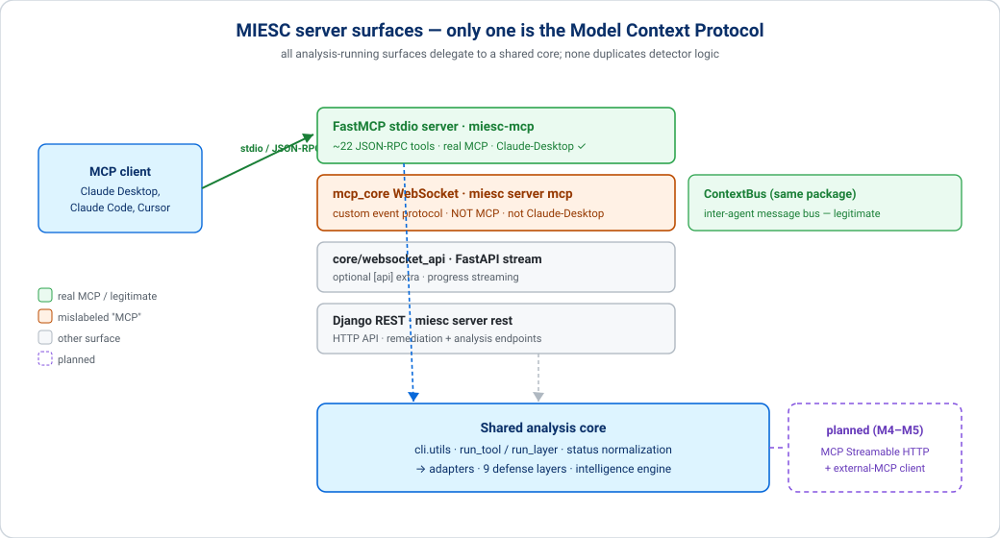
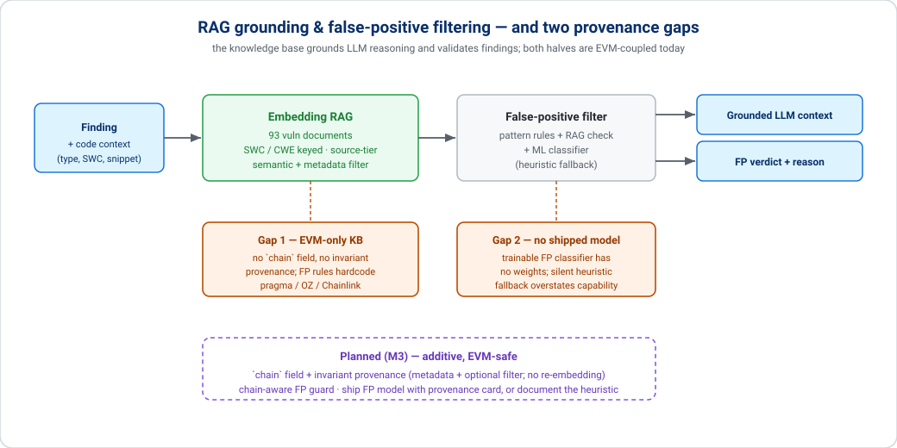
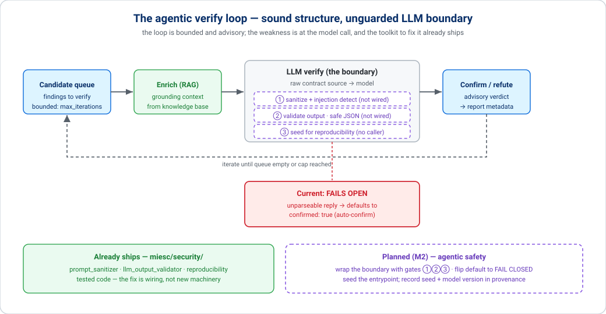
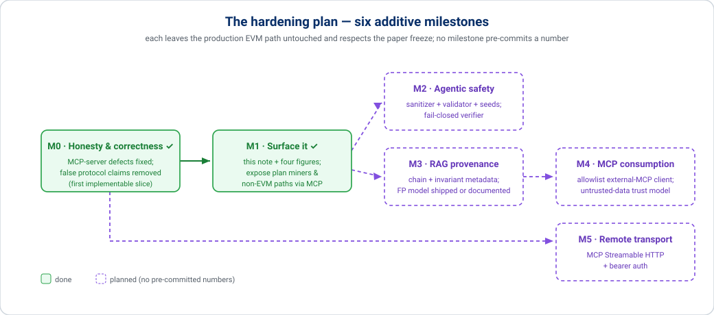

# MIESC's Agentic, RAG and MCP Architecture — Making the AI-Assistance Layer Explicit

Date: 2026-11-14
Status: architecture note + hardening plan (additive; no benchmark claims)
Companion to: [Agentic + RAG Quality Loops](./AGENTIC_RAG_QUALITY_LOOPS_20260621.md),
[SDD: MCP/RAG/Agentic Surfacing & Hardening](../sdd/SDD_MCP_RAG_AGENTIC_SURFACING_20261114.md)

## Abstract

MIESC's AI-assistance layer — its Model Context Protocol (MCP) interface, its
retrieval-augmented generation (RAG) knowledge base, and its agentic reasoning
loops — is among the project's most capable subsystems and, until now, its least
documented. This note maps that layer **as it actually exists in the code**
(verified file-by-file), names three concrete weaknesses a reviewer reaches
within minutes — a naming collision between two "MCP" surfaces, a chain-coupled
RAG, and an agentic verifier that bypasses the project's own safety toolkit — and
sets out a phased, additive plan to surface and harden it. It makes **no new
benchmark claim**; every quantitative result stays with the two papers and their
frozen claims matrices. Its contribution is architectural clarity: four figures
and a milestone plan that turn an implicit capability into a reviewable one.

## 1. The three concerns, and why they were implicit

MIESC is a pre-audit triage tool whose differentiator is not a single detector
but the *orchestration* of many, with an AI layer that (a) exposes the pipeline
to external agents (MCP), (b) grounds LLM reasoning in curated vulnerability
knowledge (RAG), and (c) runs bounded agentic loops that investigate and verify
findings. Each concern grew organically across releases, and each accreted more
capability than its documentation reflected. The result is a classic
research-tool failure mode: the capability is real, but a newcomer cannot see its
shape, and some of its self-description has drifted ahead of its behaviour. This
note fixes the visibility half; the companion SDD fixes the behaviour half.

## 2. The MCP surface map

MIESC exposes **four** server/streaming surfaces, two of which carry the name
"MCP" (Figure 1). Only one is the Model Context Protocol.

**Figure 1.** The server surfaces. The **FastMCP stdio server**
(`miesc/mcp_server.py`, console script `miesc-mcp`) is the real MCP surface: ~22
JSON-RPC tools over stdio, genuinely usable by Claude Desktop and other MCP
clients, and — importantly — it *delegates* to the existing CLI internals
(`miesc.cli.utils.run_tool` / `run_layer`) rather than duplicating analysis
logic. A second, older surface (`miesc/mcp_core/`, launched by `miesc server mcp`)
is a **custom WebSocket event stream**; it is not JSON-RPC, has no
`initialize`/`tools/list`/`tools/call`, and until this cycle its docstring
claimed MCP and Claude-Desktop compatibility it does not have. Its `ContextBus`
half is, however, a legitimate inter-agent message bus used by the agent layer. A
third surface (`miesc/core/websocket_api.py`) is a FastAPI streaming API, and a
fourth (`miesc/api/rest.py`) is a Django REST API. The design keeps the FastMCP
server as the canonical MCP surface, re-labels the custom WebSocket stack as what
it is, and adds remote MCP transport through the SDK's own Streamable HTTP rather
than the bespoke socket.

**Consumption — the missing half.** MIESC is today an MCP *server* only; it
consumes no external MCP servers. The plan adds a thin, allowlist-only MCP
*client* under a strict trust model: external MCP output is **data, never
instructions** — every response is sanitised, schema-validated, normalised
through the same tool-status vocabulary, and surfaced as advisory evidence, never
promoted to a `Finding` and never concatenated into a prompt unsanitised.

## 3. RAG — grounding, and the chain/provenance gap

MIESC's RAG (`miesc/llm/embedding_rag.py`) indexes a curated knowledge base of
**93 vulnerability documents**, each keyed by SWC/CWE with a source-tier weight,
and retrieves them to ground LLM reasoning and to validate false positives
(Figure 2). The quality loops that exploit this — adversarial FP refutation,
hallucination grounding, benign/negative patterns — are documented separately in
the [Agentic + RAG Quality Loops](./AGENTIC_RAG_QUALITY_LOOPS_20260621.md) note.

**Figure 2.** The RAG/FP pipeline and its two gaps. First, the knowledge base is
**EVM/Solidity-only**: the `VulnerabilityDocument` record has `swc_id`/`cwe_id`
but **no `chain` field**, and the pattern-based FP filter hardcodes Solidity
assumptions (pragma, OpenZeppelin, Chainlink). As MIESC reaches toward non-EVM
execution models, retrieval has no way to scope or label knowledge by chain.
Second, the trainable false-positive classifier exists in code but **no trained
model is shipped**; it silently falls back to a heuristic, which overstates the
shipped capability. The plan adds an additive `chain` field and invariant
provenance (metadata + optional filter only, to avoid re-embedding and perturbing
EVM retrieval), decouples the FP assumptions behind a chain-aware guard, and makes
the FP-model story explicit — either ship an artefact with a provenance card or
document the heuristic as the shipped behaviour.

## 4. Agentic loops — bounded, but bypassing the safety toolkit

MIESC's flagship agentic auditor (`miesc/agents/deep_audit_agent.py`) runs a
bounded investigate-and-verify loop: it iterates over candidate findings up to a
cap, enriches them with RAG, and asks an LLM to confirm or refute each (Figure 3).
The loop structure is sound — it is bounded and advisory. The weakness is at the
LLM boundary: the verifier posts the **raw contract source** to the model with no
prompt-injection screening and no schema-validated parsing, and — most important
— it **fails open**: when the model's reply cannot be parsed, it defaults to
`confirmed: true`.

**Figure 3.** The agentic verify loop and its safety gates. MIESC already ships
the exact toolkit to close this (`miesc/security/`): a prompt sanitiser and
injection detector, a Pydantic LLM-output validator with safe JSON parsing, and a
reproducibility module with global-seed control. None of it is wired into the
agentic path, and the seed control has no runtime caller — so agentic runs are
neither injection-hardened nor reproducible. The plan wraps the LLM boundary with
the sanitiser and validator, **flips the fail-open default to fail-closed**
(unparseable or re-injected output never auto-confirms), and seeds the agentic
entrypoint, recording the seed and model version in provenance. This reuses
existing, tested code; it is wiring, not new machinery.

## 5. The plan and its scope

The work is sequenced so that each step is additive, leaves the production EVM
path untouched, keeps non-EVM support at its honest Experimental tier, and
respects the paper freeze (Figure 4).

**Figure 4.** The plan as six milestones. **M0 — honesty & correctness** (the
first implementable slice): fix the MCP-server defects and the false protocol
claims. **M1 — surface the capability**: this note and its figures, plus exposing
the deterministic plan miners and non-EVM paths through MCP. **M2 — agentic
safety**: sanitiser/validator/seeds wired in, fail-closed. **M3 — RAG
provenance**: `chain`/invariant metadata and a shipped-or-documented FP model.
**M4 — MCP consumption**: the external-MCP client under the untrusted-data trust
model. **M5 — remote transport**: MCP Streamable HTTP with bearer auth. M0 is
done as a first slice; M1 is this document. The remaining milestones are open and
carry no pre-committed numbers.

## 6. Contribution, relation to the papers, and threats to validity

**Contribution.** This note does not add evidence; it adds *clarity*. It converts
an implicit, partly mis-described subsystem into a mapped one, with four figures
and a plan that a reviewer can check against the code. The detailed task and
acceptance criteria live in the companion SDD.

**Relation to the papers.** Nothing here touches the frozen scholarly core. The
two papers, their reproducibility notes, and the `paper*_claims_matrix.json` files
remain the canonical source of every quantitative claim; this note deliberately
cites none of them as its own result.

**Threats to validity.** The map is a static reading of one revision; as the code
moves, the figures must move with it (each milestone updates them). The plan's
sequencing assumes the EVM path stays the stable reference; any change there would
reorder the dependencies. And the honesty fixes in M0/M1 describe behaviour that
is corrected in flight — the figures depict the intended, hardened architecture,
with the drift called out rather than hidden.
