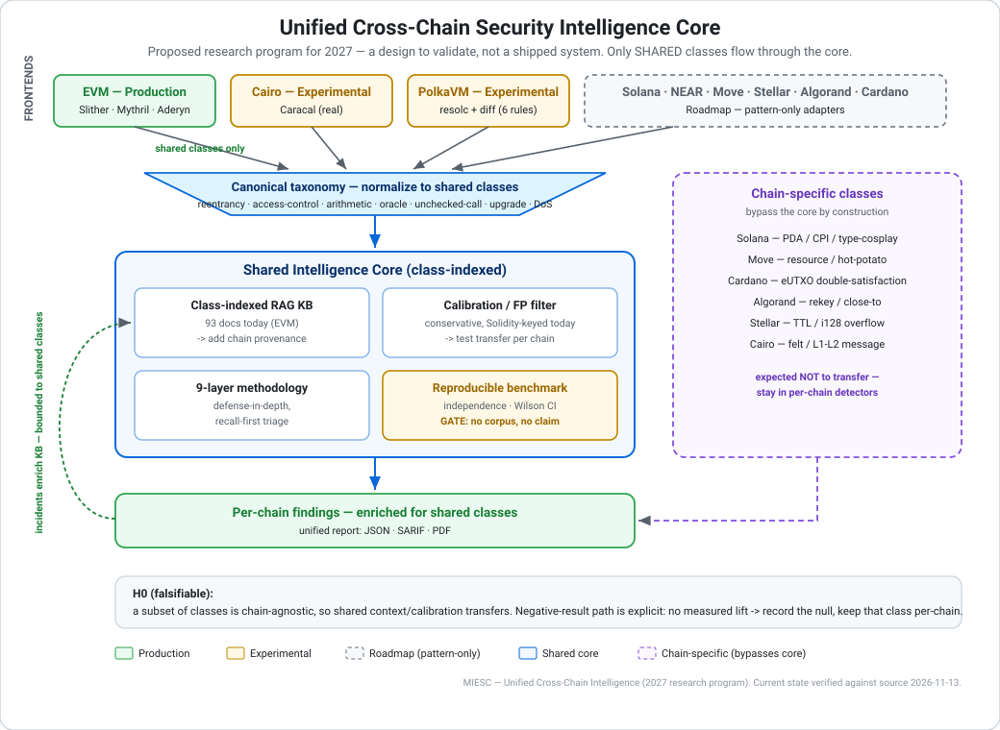

# Unified Cross-Chain Security Intelligence — A 2027 Research Program

**Status:** Research program / vision. Forward-looking.
**Date:** 2026-11-13 · **Author:** Fernando Boiero · **Applies to:** MIESC ≥ 6.8.0

> **What this document is.** A falsifiable research agenda for 2027: a set of
> hypotheses, measurable exit criteria, and an explicit negative-result path for
> turning MIESC's per-chain security analysis into a **shared intelligence core**
> that amortizes methodology, RAG, and calibration across chains.
>
> **What this document is NOT.** It is not a results paper and contains **no
> projected benchmark numbers**. Every quantitative claim about MIESC today is
> traceable to code on disk or to the canonical paper artifacts
> (`benchmarks/results/paper*_claims_matrix.json`); every future number will be
> published as a **new, dated, additive artifact**, never retro-fitted here. The
> canonical reproducible claims remain the two RIBCi–CYTED 2026 papers.

---

## 1. Motivation — the per-chain silo

MIESC's EVM path is production-grade: 9 layers, deduplication, cross-tool
Bayesian confidence, a recall-first false-positive filter, and reproducible paper
evidence (SmartBugs 95.8% recall; 11 DeFi incidents 81.8%). The non-EVM path is a
different story, and the repository is honest about it
([`docs/MULTICHAIN.md`](../MULTICHAIN.md)):

| Chain | Today | Analyzer kind |
|---|---|---|
| EVM (Solidity/Vyper) | **Production** | Real external tools (Slither, Mythril, Aderyn, Semgrep, …) |
| Cairo / Starknet | Experimental | **Real**: Caracal (Sierra static analysis) + a pattern adapter for correlation |
| Polkadot / PolkaVM | Experimental | **Real**: `resolc` compiler (class-A) + `polkavm_diff` (7 class-B heuristics) |
| Solana, NEAR, Move, Stellar, Algorand, Cardano | Roadmap | **Pattern-only** (hand-written regex/heuristic adapters) |

The deeper problem is not the adapters — it is that **all of MIESC's accumulated
intelligence is EVM-shaped**, and none of it reaches the other chains:

- **The RAG knowledge base** (`miesc/llm/embedding_rag.py`)
  holds **93 vulnerability documents**, indexed by vulnerability **class** and
  SWC/CWE — with **no `chain` field** and effectively zero non-EVM content. Its
  source-tier weighting is governed by [`docs/guides/RAG_SOURCE_POLICY.md`](../guides/RAG_SOURCE_POLICY.md).
- **The false-positive filter** (`miesc/ml/fp_filter.py`)
  keys on Solidity-specific signals: the OpenZeppelin/Safe allow-list, ERC-20
  `safeTransfer` patterns, `pragma solidity` versions, and the solc-0.8 built-in
  overflow rule. None of this applies off-EVM.
- **The canonical taxonomy** (`miesc/core/finding_taxonomy.py`)
  is a 16-member `CanonicalCategory` enum built from Slither/Aderyn/Mythril/SWC
  vocabularies, with Cairo slugs bolted on and generic cross-chain types
  deliberately left unmapped.

So every new chain starts **data-poor and alone**: a fresh regex set, no shared
corpus, no shared calibration, no shared reproducibility harness. That is the
silo this program attacks.

---

## 2. Central hypothesis (falsifiable)

> **H₀ (the bet).** A *subset* of smart-contract vulnerability classes is
> **semantically chain-agnostic**. For that subset, detection *context* (RAG
> evidence, severity calibration, FP reasoning) and *methodology* (defense-in-depth,
> recall-first triage, reproducible evaluation) can be **shared** across chains, so
> that enriching the core on one chain measurably benefits the others.

The repository already contains the empirical material to test this — not assert
it. Reading each chain adapter's own vulnerability enum, these classes **recur
across three or more execution models**:

| Shared class (candidate) | Appears in |
|---|---|
| Reentrancy | EVM, Solana, NEAR, Move, Stellar, Cairo |
| Access control / signer / auth | **All** chains |
| Arithmetic / overflow | EVM, Solana, Move, Stellar, Algorand, Cairo |
| Oracle manipulation | EVM, Solana, Move, Cairo |
| Unchecked call / return | EVM, Solana, NEAR, Move, Stellar, Cairo |
| Upgrade / proxy exposure | EVM, Solana, NEAR, Move, Cairo |
| DoS / unbounded resource | EVM, NEAR, Stellar, Algorand, Cardano |

These overlaps are **nominal**: they are matching labels across each chain's (mostly
pattern-based) adapter enum, **not demonstrated semantic equivalence**. Whether a Solana
`account_closure_reentrancy` and an EVM reentrancy are the *same* class in any useful
sense is precisely what Track **T1** is designed to test — the table is the hypothesis's
input, not its proof.

And — just as important for honesty — these are **inherently execution-model-specific**
and are **expected NOT to transfer**:

| Chain | Non-transferable classes |
|---|---|
| Solana | `pda_sharing`, `bump_seed_canonicalization`, `type_cosplay`, `arbitrary_cpi`, `duplicate_mutable_accounts`, `closing_accounts` |
| Move (Sui/Aptos) | `capability_leak`, `hot_potato_abuse`, `object_ownership`, `shared_object_race`, `witness_pattern_bypass` |
| Cardano (eUTXO) | `double_satisfaction`, `datum_hijacking`, `redeemer_injection`, `utxo_contention` |
| Algorand (TEAL) | `rekey_attack`, `close_to_attack`, `clawback_abuse`, `group_txn_validation` |
| Stellar/Soroban | `ttl_not_extended`, `i128_conversion_overflow` |
| Cairo/Starknet | `felt_overflow`, `l1_l2_message`, `unchecked_l1_call` |

**The program's job is to draw this line precisely and defend it with
measurements**, not to pretend the line is not there.

### The negative-result path (explicit)

This hypothesis can fail, and the current evidence already leans against the naive
version of it:

1. The RAG KB, FP filter, and taxonomy are **100% EVM-rooted today** — there is no
   mechanism by which that knowledge "already transfers." Any transfer must be
   built and then **measured**.
2. Pattern transfer across execution models is known to misfire. In this project's
   own history, a Solana pattern detector fired **13 findings (10 High) on a clean
   41-line Anchor program** before it was hardened — direct evidence that
   EVM-style reasoning does **not** safely carry to a different account model.
3. Several large class families (the right-hand table above) are provably
   chain-specific.

If, for a given class and chain, cross-chain context/calibration shows **no
measurable lift** over the per-chain baseline on an independent labeled corpus,
the correct result is to **record the null and keep that class per-chain**. A
negative result is a publishable, additive outcome of this program — not a
failure to be hidden.

---

## 3. The unified intelligence core (proposed architecture)

The design is a **narrow waist**: per-chain frontends normalize findings into a
shared canonical representation; a shared set of *class-indexed* services
(knowledge base, calibration, methodology, reproducible benchmark) operate on
that representation; findings return to each chain enriched. Two rules keep it
honest:

- **Only shared classes flow through the waist.** Chain-specific classes
  (§2) bypass the core and stay in their per-chain detectors. The core never
  pretends a Solana PDA bug is an EVM reentrancy bug.
- **The feedback loop is bounded.** A new chain's incidents enrich the
  class-indexed KB for shared classes only; the claimed network effect is
  explicitly limited to that subset and must be measured, not assumed.

This is a proposal to be validated, not a shipped system. It extends assets that
already exist (`CanonicalCategory`, the class-indexed RAG, the recall-safe FP
filter) rather than inventing a parallel stack.

---

## 4. Research tracks for 2027

Each track states a hypothesis, a **measurable exit criterion**, and a
**negative-result path**. No track asserts a number in advance.

### T1 — Cross-chain canonical taxonomy
Extend `CanonicalCategory` from "EVM + bolted-on Cairo" to a first-class
cross-chain taxonomy that **formally separates shared classes from
chain-specific ones**.
- **Exit:** every non-EVM adapter's vulnerability type either maps to a canonical
  shared class or is explicitly tagged chain-specific; mapping coverage is
  reported per chain. No silent fall-through.
- **Negative path:** if a class cannot be mapped without distorting EVM
  classification (the current `finding_taxonomy` "additive constraint"), it stays
  chain-specific and is documented as such.

### T2 — Class-indexed cross-chain RAG
Add explicit **chain provenance** to `VulnerabilityDocument`, seed the KB with
non-EVM incidents (per the [RAG source policy](../guides/RAG_SOURCE_POLICY.md) tiers),
and test whether cross-chain retrieval improves evidence quality for shared classes.
- **Exit:** retrieval relevance measured on a labeled non-EVM query set, against a
  per-chain-only baseline. Per the source policy, **RAG context may not create a
  benchmark claim by itself** — any detection claim is gated on T4.
- **Negative path:** no measured lift → keep the KB per-chain for that class.

### T3 — Transfer of calibration / FP reasoning
MIESC's learned FP classifier is `miesc/ml/fp_ml_classifier.py` (the main
`fp_filter.py` is pattern + RAG, threshold-gated). Test whether EVM-learned
calibration transfers to a non-EVM chain, or whether per-chain calibration is required.
- **Exit:** precision/recall on an independent non-EVM labeled set, with Wilson
  95% CIs, compared to the per-chain baseline; recall preserved relative to that
  baseline (the filter stays conservative — the `off` preset never filters).
- **Negative path:** transfer underperforms → per-chain calibration, documented.

### T4 — Unified reproducible benchmark methodology (the gate)
Generalize the methodology already scoped for Cairo in
[`docs/plans/2026-11-11_CAIRO_BENCHMARK_CORPUS_M2.md`](../plans/2026-11-11_CAIRO_BENCHMARK_CORPUS_M2.md)
to every chain: **independence** (no author-labeled N=1 fixtures, no analyzer's
own test suite), per-entry **provenance + AGPL-compatible license**, **patched
negatives** for precision, and **Wilson 95% CIs**.
- **Exit:** a credible, independently-sourced corpus per chain before *any*
  recall/precision claim for that chain. The blocker is ground truth, not tooling.
- **Negative path:** no credible corpus → the chain stays Experimental/Roadmap and
  makes **no** quantitative claim. This track **gates** T2 and T3.

### T5 — Methodology generalization
Apply the 9-layer defense-in-depth and recall-first triage uniformly; where a
layer has no analog on a chain (e.g. EVM symbolic execution on a non-EVM target),
**document the gap** rather than papering over it.
- **Exit:** a per-chain layer-coverage matrix, published as a dated artifact.
- **Negative path:** a layer that cannot be realized on a chain is marked N/A with
  the reason.

---

## 5. Expected benefit — and its honest bound

The hoped-for payoff is **amortization with a network effect**: once the core
carries a shared class well, every chain that recognizes that class inherits the
evidence and calibration, so the *marginal* cost of adding a chain falls and each
new chain's incidents enrich the shared corpus for all.

That benefit is **bounded to the shared-class subset** and is itself a hypothesis
to be measured under T2–T4, not a promised outcome. Chain-specific classes see no
such amortization by construction, and the program says so up front.

---

## 6. Risks and what would falsify this program

- **EVM-centrism is real, not rhetorical.** KB, FP filter, and taxonomy are
  Solidity-shaped today; "transfer" is engineering + measurement, not a free lunch.
- **Ground-truth scarcity.** As the Cairo M2 scoping shows, even one chain lacks a
  credible independent corpus; T4 is the long pole for all chains.
- **Over-generalization.** Forcing a chain-specific bug into a shared class would
  *lower* precision — the exact failure mode behind the 13-FP Solana regression.
  The shared/chain-specific split (§2) is the guardrail.
- **Falsification.** If, across the candidate shared classes, cross-chain context
  and calibration yield no measurable lift on independent corpora, H₀ is rejected
  and MIESC remains a federation of per-chain analyzers with a shared *methodology*
  only — still a useful, honest outcome.

---

## 7. Milestones (2027, artifact-gated, no projected numbers)

| Quarter | Milestone | Additive dated artifact |
|---|---|---|
| Q1 | T1 taxonomy split + T4 methodology generalized from Cairo M2 | taxonomy map + per-chain corpus protocol |
| Q2 | First independent corpus for one Experimental chain (Cairo or Polkadot) | labeled corpus + provenance/license ledger |
| Q3 | T2 class-indexed RAG with chain provenance; retrieval measured | retrieval-relevance report (per-chain baseline vs shared) |
| Q4 | T3 calibration-transfer study on that chain, with Wilson CIs | transfer study (positive **or** null result) |

Each milestone lands as a new dated file under `docs/research/` or
`benchmarks/results/`; none overwrites paper evidence.

---

## 8. Relation to the existing papers and roadmap

This program is **additive future work** on top of the two RIBCi–CYTED 2026
papers — Paper 1 (multi-layer detection) and Paper 2 (verifiable remediation) —
both of which are EVM/Solidity. It does not restate or revise their numbers.
The platform-alignment plan
([`docs/roadmap/PAPER_LEARNINGS_PLATFORM_ALIGNMENT.md`](../roadmap/PAPER_LEARNINGS_PLATFORM_ALIGNMENT.md))
maps paper results onto CLI/API/MCP contracts and is EVM-scoped; the cross-chain
direction lives in [`docs/MULTICHAIN.md`](../MULTICHAIN.md) and in
[`docs/ROADMAP.md`](../ROADMAP.md), which this document extends.

**Related references**

- [`docs/MULTICHAIN.md`](../MULTICHAIN.md) — per-chain status legend and support levels
- [`docs/ROADMAP.md`](../ROADMAP.md) — forward-looking roadmap (links here)
- [`docs/guides/RAG_SOURCE_POLICY.md`](../guides/RAG_SOURCE_POLICY.md) — RAG source tiers and weighting
- [`docs/plans/2026-11-11_CAIRO_BENCHMARK_CORPUS_M2.md`](../plans/2026-11-11_CAIRO_BENCHMARK_CORPUS_M2.md) — the corpus methodology this program generalizes
- `benchmarks/results/paper1_claims_matrix.json`, `paper2_claims_matrix.json` — canonical claims

---

*This is a living research plan. Measurements supersede intentions: where a track
produces a null result, the null is recorded and this plan is updated to match the
evidence.*
