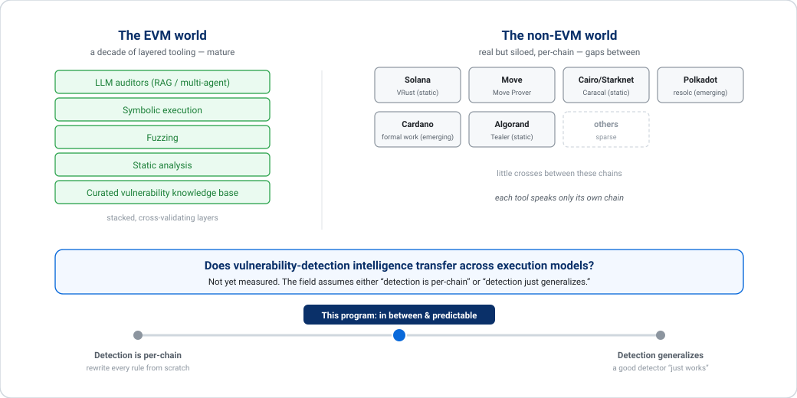
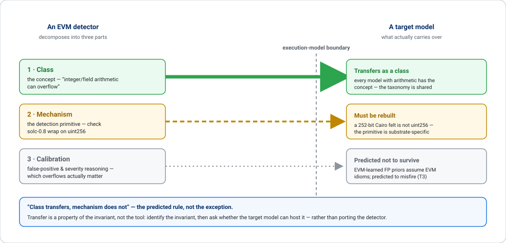
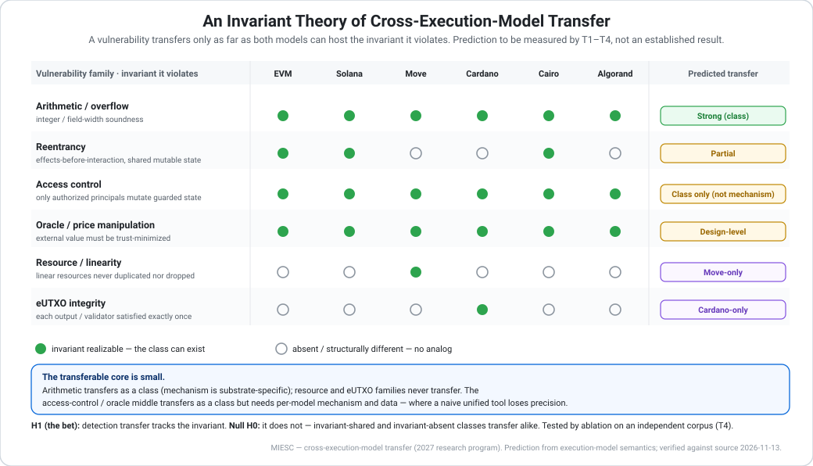
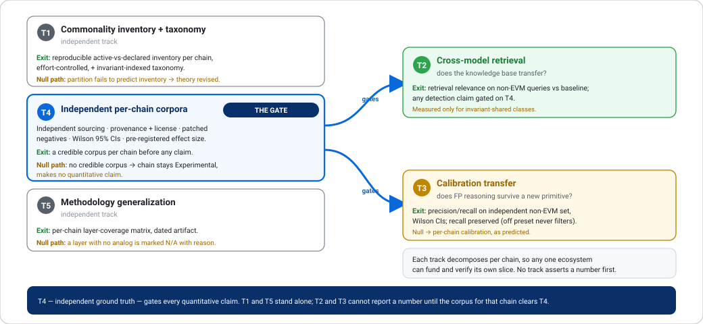
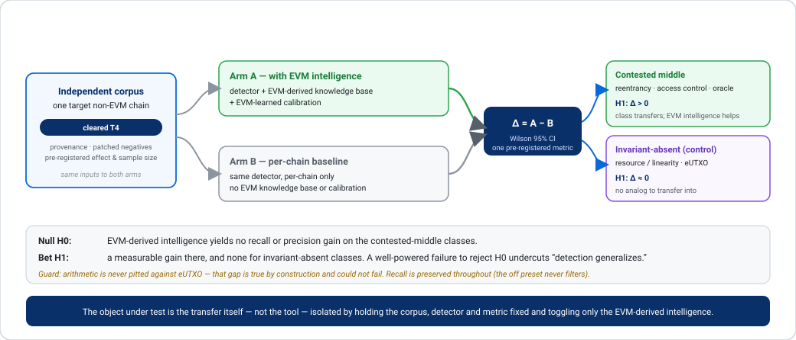

# Does Security Intelligence Transfer Across Execution Models? — A 2027 Research Program

**Fernando Boiero** — MIESC · Multi-layer Intelligent Evaluation for Smart Contracts · github.com/fboiero/MIESC
Version 2026-11-14 · Applies to MIESC ≥ 6.8.0 · Status: research program (forward-looking)

## Abstract

Smart-contract security tooling is sharply asymmetric: the EVM has a decade of
static analyzers, fuzzers, symbolic executors and LLM auditors, while the non-EVM
execution models — Solana accounts, Move resources, Cardano's eUTXO, Cairo/Starknet,
Algorand/TEAL — have real but siloed per-chain tools and little that crosses chains.
This raises a question the field has not answered, or asked rigorously: **does
vulnerability-detection intelligence transfer across execution models, and if so,
which part of it and how far?** We propose a falsifiable research program built on an
*invariant theory of transfer* — a vulnerability is the violation of an invariant,
and an invariant transfers across execution models exactly to the extent that both
models can express the state and control flow it constrains — which predicts the
transfer boundary from execution-model semantics rather than from any particular tool.
The theory argues *against* naive unification: the transferable core is small, and the
lucrative-looking middle transfers as a *class* but not as a *mechanism*. We set out
the measurement that can confirm or refute it — independent per-chain corpora,
cross-model retrieval and calibration ablations, with pre-registered effect sizes and
Wilson 95% confidence intervals — including a publishable negative result. The program
states **no projected benchmark numbers**; every future measurement is an additive,
dated artifact, and each chain is a standalone, independently fundable unit. The
canonical reproducible claims remain the two RIBCi–CYTED 2026 papers.

**Keywords:** smart-contract security · cross-execution-model transfer · invariant
theory · vulnerability taxonomy · retrieval-augmented generation · calibration
transfer · EVM · Solana · Move · Cardano eUTXO · Cairo/Starknet · Algorand

## 1. The question the field skipped

Smart-contract security tooling is sharply asymmetric. The EVM has a decade of static
analyzers, fuzzers, symbolic executors and, lately, LLM auditors. The non-EVM world —
Solana, Move (Sui/Aptos), Cairo/Starknet, Cardano, Algorand — has real but siloed
per-chain tools (the Move Prover [6]; static/fuzzing tools such as VRust for Solana [5];
Caracal for Cairo [7]; Tealer for Algorand [10]; emerging formal-verification work for
Cardano) and little that crosses chains. MIESC lives on exactly this
frontier: its EVM path is mature (reproducible evidence — SmartBugs **95.8% recall** on
the LLM-free profile; 11 DeFi incidents 81.8%), its Cairo and Polkadot paths integrate
*real* external analyzers (Caracal; the `resolc` compiler plus seven `polkavm_diff`
heuristics), and the remaining non-EVM adapters are explicitly pattern-only and
Roadmap-stage ([`docs/MULTICHAIN.md`](../MULTICHAIN.md)). The asymmetry is the backdrop
for this program (Figure 1).

Faced with that asymmetry, the field has quietly adopted one of two **untested
assumptions**:

1. *Detection is per-chain.* Every new chain means a hand-written rule set from
   scratch — the status quo for the non-EVM analyzers, MIESC's included.
2. *Detection generalizes.* A good detector, knowledge base, or LLM "just works" on
   the next chain.

**Neither has been measured across execution models.** If (2) held even partially,
the marginal cost of securing a new chain would collapse; if it fails, the
"multi-chain security tool" category is, for its non-EVM part, largely unvalidated.
This program's thesis is that the truth is *in between, and predictable* — and that,
to our knowledge, nobody has drawn the line with evidence.

**Figure 1.** The tooling asymmetry. The EVM has a mature, layered and cross-validating
detection stack; the non-EVM world has sparse, siloed per-chain tools with gaps between
them. The open question is whether detection intelligence transfers across execution
models; this program's thesis is that it transfers partially and predictably — neither
"per-chain" nor "generalizes".

**Scope and non-claims.** This is not a claim that MIESC has a "unified brain" for all
chains, and it contains **no projected benchmark numbers**. The reasoning below argues
*against* naive unification. Every quantitative claim about MIESC today is traceable to
source (`benchmarks/results/paper*_claims_matrix.json`) or stated as a preliminary,
method-limited observation (§3). Every future number will be an additive, dated
artifact. Each chain's work is a **standalone, independently fundable unit** — no result
depends on buying the whole program. The canonical reproducible claims remain the two
RIBCi–CYTED 2026 papers.

## 2. Where this sits — related work and the gap

The adjacent literature is real but stops short of the question, consistently.

**EVM-bound RAG/LLM auditing (crowded).** A fast-growing line pairs a vector store of
known vulnerabilities with an LLM — e.g. Yu's RAG+GPT-4 auditor over 830 vulnerable
contracts (62.7% guided / 60.7% blind, human review still advised) [1] — plus several
multi-agent retrieval pipelines. All Solidity/EVM. MIESC's own class-indexed RAG (93
vulnerability documents, SWC/CWE-keyed, **no chain field**) is one more point in this
EVM-shaped cloud. *RAG-for-vulnerabilities is neither novel nor cross-chain.*

**Cross-*language* transfer — inside one execution model.** The closest transfer claim
is a zero-shot detector for Vyper trained on Solidity only, over three vulnerability
types (Hu, Zeng & Luo [2]). Solidity and Vyper are *different languages on the same
EVM*; the transfer never crosses an execution-model boundary.

**Non-EVM LLM detection — but on synthetic, self-made data.** Boi & Esposito [3]
evaluate prompt-engineering vs fine-tuning for LLM detection on Solana (Rust) and
Algorand (PyTeal) — and had to **build their own synthetic labeled dataset**, noting
that labeled datasets for non-EVM platforms are lacking. They conclude detection is
viable *with domain-specific data*, and that platform architecture shapes how
vulnerabilities appear and can be detected — which both confirms the ground-truth gap
this program targets and hints at the execution-model dependence §4 formalizes, though
their evidence rests on self-authored synthetic data.

**Taxonomies — one or two models at a time.** EVM catalogs (the SWC Registry [8];
hierarchical taxonomies such as OpenSCV [9]) and a MoveEVM Weakness Classification of
37 types for Move-in-EVM (MWC, Topal [4]) cover at most two adjacent models. **We found
no published taxonomy that spans the account, resource, eUTXO and Cairo models
together** (as of 2026-11), and execution-model security is otherwise discussed only
conceptually (UTXO-vs-account trade-offs), without detection tooling or transfer
measurement.

**Table 1.** Where the adjacent literature stops. No prior line frames
cross-execution-model transfer as a measurable question answered with independent data.

| Prior work | Covers | Crosses an execution model? | Independent corpus? |
|---|---|---|---|
| RAG/LLM auditors (Yu [1]; pipelines) | EVM/Solidity | No | — |
| Solidity-only zero-shot [2] | Solidity → Vyper | No (both EVM) | — |
| Boi & Esposito [3] | Solana, Algorand | — | **No (synthetic)** |
| MWC [4]; OpenSCV [9]; SWC [8] | Move-in-EVM / EVM | No | — |
| **This program** | **EVM · Solana · Move · eUTXO · Cairo · TEAL** | **The question itself** | **Yes (T4)** |

To our knowledge, the gap is that **cross-execution-model transfer has not been framed
as a measurable question, answered with independent data, or predicted from
execution-model semantics.**

*Positioning drawn from targeted literature searches on 2026-11-13 — cross-chain
vulnerability taxonomies, non-EVM transfer learning, RAG-based auditing, and Solana /
Move / Algorand benchmarks — not an exhaustive survey.*

## 3. A preliminary look — what cross-chain detection is today

Before theorizing transfer, we looked at where it is supposed to already exist: inside
MIESC's own non-EVM adapters. **This section is motivating, not conclusive.** A clean
per-label verdict requires tracing every emission path — enum references *and* the
pattern-string path each adapter also uses — and a reliable, reproducible version of
that inventory is **Track T1**, not a result claimed here. A quick grep conflates
vulnerability labels with opcode and regex constants and must not be trusted; below we
report only what survives a careful trace or is trivially checkable.

Two signs are cleanly reproducible and already telling:

- **The shared knowledge base is EVM-shaped to the core.** MIESC's RAG store holds 93
  vulnerability documents, **no `chain` field**, and essentially zero non-EVM content —
  so whatever "shared" vocabulary the adapters declare, the shared *evidence* behind it
  is Solidity-only.
- **Some cross-chain "shared" cells have no detector behind them at all.** Algorand
  declares no DoS/unbounded-resource label, so a notional cross-chain "shared DoS" has
  nothing to rest on there; its real update-exposure detector sits under a different
  label entirely.

Everything beyond those two needs care: a naive grep conflates vulnerability labels with
opcode and regex constants, and several adapters emit through a pattern-string path the
enum trace misses — so a trustworthy active-vs-declared inventory per chain (how much of
each adapter's declared vocabulary a detector actually produces) is **Track T1**, not a
number claimed here. What inspection *suggests*, and T1 must confirm, is that declared
labels run well ahead of active detectors and that the active ones concentrate in Cairo —
which is itself regex-based, with the strong external analyzer (**Caracal** [7]) outside
this label audit entirely.

**What this does and does not show.** A declared-but-inactive label shows a detector
was *not built* — **not** that the class *cannot transfer*. And a serious rival
explanation confounds the pattern: Cairo and Solana received focused effort (Cairo's
M1/M2 corpus work and Caracal correlation; a Solana hardening pass), while the other
adapters got scaffolding. "Detectors cluster where the invariant allows transfer" and
"detectors cluster where effort went" predict the same picture here. Disentangling them
is precisely what an independent, effort-controlled measurement (T1–T4) is for.

So the preliminary picture — nominal labels far ahead of active detectors, concentrated
where work was done — is enough to **motivate** the program and to warn against assuming
cross-chain commonality. It is **not** evidence for the theory of §4; T1 tests that.

## 4. An invariant theory of transfer (predictions to be tested)

The engine of this program is one claim: **a vulnerability is the violation of an
invariant, and an invariant transfers across execution models exactly to the extent
that both models can express the state and control flow the invariant constrains.**
The table is the theory's **prediction**, to be confirmed or refuted by T1–T4 — both
the transfer column *and* the "models that realize it" column are claims to verify, not
established facts. It separates three things usually conflated, which transfer
*independently*: the **class** (the concept), the **mechanism** (the concrete detection
primitive), and the **calibration** (false-positive and severity reasoning). Figure 2
makes that decomposition concrete.

**Figure 2.** The three parts of a detector are predicted to transfer independently. The
*class* (the concept) transfers broadly; the *mechanism* (the concrete detection
primitive) is substrate-specific and must be rebuilt; the *calibration* (false-positive
and severity reasoning) is predicted not to survive a change of primitive (tested by T3).
Worked example: arithmetic overflow — the class is shared, but `uint256` reasoning does
not carry to a 252-bit Cairo field.

**Table 2.** An invariant theory of cross-execution-model transfer. Each row is a
prediction from execution-model semantics, to be confirmed or refuted by T1–T4.

| Vulnerability family | Invariant it violates | Models predicted to realize it | Predicted transfer |
|---|---|---|---|
| Arithmetic / overflow | integer/field-width soundness | all | **Class: strong. Mechanism: substrate-specific** (solc-0.8 checks ≠ Cairo `felt` 252-bit field) |
| Reentrancy | effects-before-interaction under shared mutable state + synchronous re-entry | EVM, Solana (CPI), Cairo; absent/rewritten under Move, eUTXO, Algorand | **Partial** — real only where the control-flow invariant exists |
| Access control | only authorized principals mutate guarded state | all (authority is universal) | **Class transfers; mechanism does not** — every model has a different auth primitive |
| Oracle / price manipulation | external value must be trust-minimized | all that read external value | **Design-level** — class transfers; detection needs per-model data sources |
| Resource / linearity (hot-potato, capability leak) | linear resources are neither duplicated nor dropped | linear-type systems (Move) | **None** — no analog off-Move |
| eUTXO integrity (double-satisfaction, datum hijacking) | each output/validator satisfied exactly once | eUTXO (Cardano) | **None** — no analog off-eUTXO |

The "models predicted to realize it" column states the theory's *semantic claims* —
e.g. that eUTXO has no shared mutable state to re-enter — not citations to each runtime's
specification; sourcing every cell to primary runtime documentation is itself part of T1.

Note the correction this forces on our own prior framing: Cairo's `felt_overflow` is
**not** a chain-specific class — MIESC's taxonomy already collapses it into the shared
ARITHMETIC class (`finding_taxonomy.py`). It is the textbook case of **class transfers,
mechanism does not**: a 252-bit prime field is arithmetic, but nothing about `uint256`
reasoning carries to it.

Two consequences follow, each testable:

- **The transferable core is small; the lucrative-looking middle is a trap.**
  Arithmetic transfers as a class; linear-resource and eUTXO families never will; the
  large access-control/oracle middle transfers as a *class* but demands per-model
  *mechanism* and *data* — precisely where a naive unified tool loses precision.
- **Transfer is a property of the invariant, not the tool.** The engineering question
  becomes "identify the invariant, then ask whether the target model can host it" — not
  "port the detector."

If the theory holds, it explains why honest multi-chain tools degrade off-EVM and hands
practitioners a map of where sharing pays. If it fails — if invariant-shared classes do
not transfer, or invariant-absent ones do — that is itself a finding about the field's
assumptions.

**Figure 3.** The invariant matrix. For each vulnerability family and the invariant it
violates, the matrix marks which execution models can realize that invariant (filled =
realizable; hollow = absent or structurally different) and the predicted transfer — a
prediction from execution-model semantics, to be measured by T1–T4, not an established
result.

## 5. The research program

Each track states a **measurable exit criterion** and an **explicit negative-result
path**, and **decomposes per chain** so any one ecosystem can fund and verify its slice.
No track asserts a number in advance. The dependencies are deliberately few (Figure 4):
only T4 gates another track; T1 and T5 stand alone.

**Figure 4.** The program as five tracks. T4 — independent per-chain corpora — is the
gate: no quantitative claim is made for a chain until its corpus clears T4, so T4 gates
T2 and T3. T1 (commonality inventory and taxonomy) and T5 (methodology generalization)
are independent and stand alone. Each track carries an exit criterion and an explicit
negative-result path.

### T1 — The commonality inventory + execution-model-aware taxonomy
Do the §3 audit *properly*: a full, reproducible emission inventory per adapter (enum
and pattern paths, mapped to canonical classes), controlling for effort. Then re-express
the 16-member `CanonicalCategory` as an invariant-indexed taxonomy separating
**class-transfer** from **mechanism-transfer** and flagging label-only matches.
- **Exit:** a published, reproducible active-vs-declared inventory per chain, plus a
  taxonomy whose real-vs-nominal split matches §4's predictions or refutes them.
- **Negative path:** if the partition does not predict the inventory once effort is
  controlled, the theory is wrong and is revised against the data.

### T2 — Cross-execution-model retrieval (does the KB transfer?)
Add chain/invariant provenance to the RAG documents; measure whether cross-model
retrieval helps for *invariant-shared* classes only.
- **Exit:** retrieval relevance on a labeled non-EVM query set vs a per-chain baseline;
  per MIESC's own source policy, RAG context may not create a benchmark claim by itself,
  so any detection claim is gated on T4.
- **Negative path:** no measured lift → the KB stays per-chain for that class.

### T3 — Calibration transfer (does FP reasoning survive a change of primitive?)
MIESC's FP learner is `miesc/ml/fp_ml_classifier.py` (scikit-learn; the main
`fp_filter.py` is pattern + RAG, Solidity-keyed). A trained model is **not shipped** — a
stock install runs the rule-based fallback — so T3 both ships a trained artifact and
tests whether EVM-learned calibration survives off-EVM. §4 predicts it mostly will not.
- **Exit:** precision/recall on an independent non-EVM labeled set with Wilson 95% CIs
  vs the per-chain baseline, one comparison and one metric pre-registered; recall
  preserved (the `off` preset never filters).
- **Negative path:** underperforms → per-chain calibration, documented as predicted.

### T4 — Independent per-chain corpora (the gate, and the fundable unit)
The program is only as credible as its ground truth — and, as Boi & Esposito [3] show,
the field currently resorts to synthetic self-made data. Generalize the methodology
scoped for Cairo ([the M2 benchmark-corpus plan](../plans/2026-11-11_CAIRO_BENCHMARK_CORPUS_M2.md)):
**independence** (no author-labeled N=1 fixtures, no analyzer's own test suite),
per-entry **provenance + AGPL-compatible license**, **patched negatives** for precision,
**Wilson 95% CIs**, and a **pre-registered effect size and sample size** so a null is
informative, not merely underpowered.
- **Exit:** a credible, independently-sourced corpus per chain before any
  recall/precision claim for that chain. Each corpus is the artifact its ecosystem can
  fund and audit.
- **Negative path:** no credible corpus → the chain stays Experimental and makes **no**
  quantitative claim. This track **gates** T2 and T3.

### T5 — Methodology generalization
Apply the defense-in-depth layering and recall-first triage uniformly; where a layer has
no analog on a chain (e.g. EVM symbolic execution on a non-EVM target), **document the
gap** rather than paper over it.
- **Exit:** a per-chain layer-coverage matrix, published as a dated artifact.
- **Negative path:** a layer that cannot be realized is marked N/A with the reason.

## 6. Contributions and threats to validity

The claim to novelty is specific and bounded. It is **not** "one brain for all chains"
(we reject that). It is three things the field does not have:

1. **A reproducible commonality inventory** (the real T1) — the first measured account
   of how much cross-chain "shared-class" detection is actually implemented versus
   merely declared, effort controlled.
2. **An invariant theory that predicts the transfer boundary in advance** (§4) — turning
   cross-chain security from porting rules into reasoning about which model can host
   which invariant.
3. **Independent, per-chain corpora** (T4) that make every claim auditable by the
   ecosystem that cares most — the alternative to synthetic self-made ground truth.

**Figure 5.** The falsification test as a controlled ablation. Holding the corpus (which
has cleared T4), the detector and the metric fixed, only the EVM-derived knowledge base
and calibration are toggled. The difference is measured with Wilson 95% CIs on the
contested-middle classes, where H1 predicts a gain, and on invariant-absent classes,
which act as a control where none is expected. Arithmetic is never pitted against eUTXO —
that gap is true by construction. On the Cairo pilot the invariant-absent control is
vacuous (those classes are absent on Cairo), so exercising it needs a Move or Cardano
corpus.

**Falsification is built in, tied to a concrete test (Figure 5).** The object under test
is an *ablation*: on an independent corpus for a target non-EVM chain, the same detector
is run with and without the EVM-derived knowledge base and calibration, against a
per-chain-only baseline. The null (**H0**) is that the EVM-derived intelligence yields
**no** recall or precision gain on the **contested-middle** classes — reentrancy, access
control, oracle — the ones §4 predicts transfer as a *class* but not as a *mechanism*.
Our bet (the alternative, **H1**) is a measurable gain for those classes and not for
invariant-absent ones. We deliberately do *not* pit arithmetic against eUTXO integrity:
§4 makes that gap true by construction, so it could not fail. A *well-powered* T4 study
that fails to reject H0 undercuts the "detection generalizes" assumption; the Q2–Q4
pilots can only rule a large effect in or out, not settle a tight null.

**Threats to validity.** Building independent corpora for several execution models is
hard; the program is decomposed per chain and expects to land one model at a time. The
first corpus increment (Cairo M2, ~10–15 contracts) is a **pilot**, sized for a large
effect, not a tight null. The §3 effort confound is real and is addressed by the
effort-controlled inventory of T1. And neutrality is a requirement, not a slogan: a tool read as "EVM wrapping other
chains" will not — and should not — earn non-EVM trust. Depth per model, in the open, is
the price of admission.

## 7. Milestones — a Cairo pilot and an open agenda

The only timeline committed here is an **author-run pilot on one model** — Cairo/Starknet,
whose corpus is already scoped. Because Cairo is account-based, that pilot can speak to the
arithmetic and "class-transfers / mechanism-doesn't" rows, but **not** to the eUTXO or
linear-resource rows. Every other chain is an **open invitation**, not a personal
deliverable: a self-contained T4 corpus that its own ecosystem or outside contributors can
fund and run on their own schedule. This is a research agenda to join, not a solo sprint to
finish — which is also what keeps it neutral.

**Table 3.** The Cairo pilot timeline. Each milestone lands as a dated artifact; none
overwrites paper evidence. Chains beyond Cairo extend the same template as independent,
contributable slices.

| Quarter | Milestone | Additive dated artifact |
|---|---|---|
| Q1 | T1 reproducible emission inventory (effort-controlled) + invariant taxonomy; §4 predictions registered for the chains it does not yet cover | inventory report + invariant taxonomy + prediction ledger |
| Q2 | First **independent** corpus clears T4 for Cairo (pilot power stated) | labeled corpus + provenance/license ledger |
| Q3 | T2 cross-model retrieval measured against that corpus | retrieval-relevance report (per-chain baseline vs shared) |
| Q4 | T3 calibration-transfer pilot on Cairo, with Wilson CIs | transfer study — first measured cross-model point (positive **or** null) |

The Q1–Q4 milestones above are the Cairo pilot; each lands as a dated file under
`docs/research/` or `benchmarks/results/`, and none overwrites paper evidence. Chains
beyond Cairo extend the same template as independent, contributable slices. The §3 audit
was exploratory; the registered predictions are what T1 holds to account.

## 8. Relation to the existing papers and roadmap

This program is **additive future work** on the two RIBCi–CYTED 2026 papers — Paper 1
(multi-layer detection) and Paper 2 (verifiable remediation), both EVM/Solidity. It does
not restate or revise their numbers. The platform-alignment plan
([`docs/roadmap/PAPER_LEARNINGS_PLATFORM_ALIGNMENT.md`](../roadmap/PAPER_LEARNINGS_PLATFORM_ALIGNMENT.md))
is EVM-scoped; the cross-chain direction lives in
[`docs/MULTICHAIN.md`](../MULTICHAIN.md) and [`docs/ROADMAP.md`](../ROADMAP.md), which
this document extends.

## References

[1] Yu, J. *Retrieval Augmented Generation Integrated LLMs in Smart Contract Vulnerability Detection.* arXiv:2407.14838, 2024.

[2] Hu, M., Zeng, Q., Luo, L. *Zero-Shot Vulnerability Detection in Low-Resource Smart Contracts Through Solidity-Only Training.* arXiv:2603.21058, 2026.

[3] Boi, B., Esposito, C. *Prompt Engineering vs. Fine-Tuning for LLM-Based Vulnerability Detection in Solana and Algorand Smart Contracts.* arXiv:2511.11250, 2025.

[4] Topal, S. *A Systematic Classification of Vulnerabilities in MoveEVM Smart Contracts (MWC).* arXiv:2505.19047, 2025.

[5] Cui, S., Zhao, G., Gao, Y., Tavu, T., Huang, J. *VRust: Automated Vulnerability Detection for Solana Smart Contracts.* In Proc. ACM SIGSAC Conference on Computer and Communications Security (CCS '22), 2022. doi:10.1145/3548606.3560552.

[6] Zhong, J. E., Cheang, K., Qadeer, S., Grieskamp, W., Blackshear, S., Park, J., Zohar, Y., Barrett, C., Dill, D. L. *The Move Prover.* In Proc. 32nd International Conference on Computer Aided Verification (CAV '20), pp. 137–150, 2020.

[7] Crytic. *Caracal: a static analyzer for Starknet smart contracts.* GitHub: crytic/caracal, 2023.

[8] SmartContractSecurity. *Smart Contract Weakness Classification (SWC) Registry.* swcregistry.io, 2020.

[9] Vidal, F. R., Ivaki, N., Laranjeiro, N. *OpenSCV: An Open Hierarchical Taxonomy for Smart Contract Vulnerabilities.* Empirical Software Engineering, 2024. doi:10.1007/s10664-024-10446-8. Preprint arXiv:2303.14523, 2023.

[10] Crytic (Trail of Bits). *Tealer: a static analyzer for Algorand TEAL programs.* GitHub: crytic/tealer (accessed 2026).

**Internal references**

- [`docs/MULTICHAIN.md`](../MULTICHAIN.md) · [`docs/guides/RAG_SOURCE_POLICY.md`](../guides/RAG_SOURCE_POLICY.md) · [the M2 benchmark-corpus plan](../plans/2026-11-11_CAIRO_BENCHMARK_CORPUS_M2.md) · `benchmarks/results/paper1_claims_matrix.json`, `paper2_claims_matrix.json`

---

*This is a living research plan. Measurements supersede intentions: where a track
produces a null result, the null is recorded and the theory of §4 is revised to match
the evidence.*
